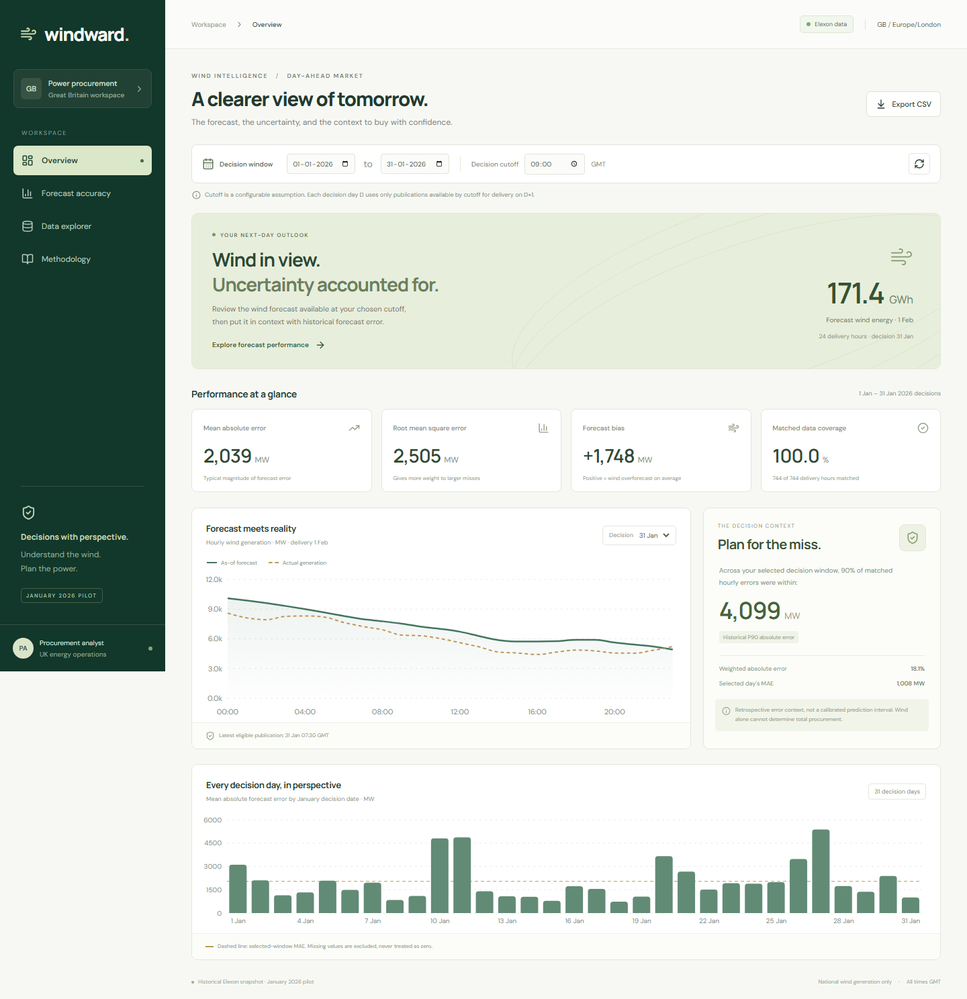

# Windward

Day-ahead wind intelligence for a UK energy procurement team. Built with **React + TypeScript**, **Python + FastAPI**, and **Docker**.

**Public repository:** https://github.com/ss1290/q7m2vx

**Hosted app:** https://q7m2vx-nu.vercel.app

**Demo video:** https://youtu.be/oHUIEhUa5RE

The 4:15 demo uses a natural neural narration voice. A local copy is available at `artifacts/windward-demo.mp4`.

**AI disclosure:** OpenAI Codex assisted with domain research, implementation, styling, tests, documentation, and demo preparation. The data are real Elexon responses, not AI-generated or synthetic.



## What the pilot does

- Replays the wind forecasts actually available at a configurable January 2026 decision cutoff.
- Compares those forecasts with aligned hourly actual generation.
- Shows MAE, RMSE, signed bias, WAPE, empirical P90 absolute error, daily error, and coverage.
- Provides publication timestamps, forecast lead times, an audit table, and CSV export.
- Explains the selection rules and snapshot provenance directly in the UI.

This is an intelligence tool for the wind contribution, not a complete procurement optimiser. Demand, other generation, positions and prices are outside the requested scope, so the app does not invent a total purchase recommendation.

## Start with Docker

Requirements: Docker Desktop (engine running) and Docker Compose.

```sh
docker compose up --build
```

Open **http://localhost:8000**. React and the API are served on the same origin. No API keys or database are needed. The multi-stage image compiles the frontend, installs Python dependencies, and runs as an unprivileged user.

```sh
docker compose down
```

## Start locally

Requirements: Node.js 22+ and Python 3.12+. Python 3.14 was used for local verification; Docker targets 3.12.

```sh
python -m venv .venv
```

On Windows PowerShell:

```powershell
.venv\Scripts\python.exe -m pip install -r requirements.txt
npm.cmd ci
npm.cmd run build
.venv\Scripts\python.exe -m uvicorn backend.main:app --host 127.0.0.1 --port 8000
```

On macOS/Linux:

```sh
.venv/bin/python -m pip install -r requirements.txt
npm ci
npm run build
.venv/bin/python -m uvicorn backend.main:app --host 127.0.0.1 --port 8000
```

Open **http://localhost:8000**. For frontend development run `npm run dev` in a second terminal and open **http://localhost:5173**; Vite proxies `/api` to Python on port 8000.

## Domain assumptions and correctness

1. **January refers to decision dates**, 1-31 January 2026 inclusive. Delivery days are 2 January-1 February 2026, producing 744 hourly targets. January 1 delivery is excluded because its day-ahead decision was in December.
2. **09:00 Europe/London is an assumed cutoff**, not an asserted exchange gate closure. Change it in the UI. London is GMT throughout this study period.
3. For every delivery target on D+1, choose the greatest WINDFOR `publishTime` less than or equal to D's cutoff. Ties select the first source record; exact versions are deduplicated during ingestion. Selection is per target; the audit table exposes mixed publication times if they occur.
4. Actual responses showed **hourly WINDFOR targets**, despite the broad assignment description referring to a 30-minute target resolution. FUELHH actuals are half-hourly. Compare each hourly forecast against the mean of its two half-hour actuals. Both must be present. Do not sum MW or duplicate hourly forecasts into two pseudo-independent accuracy observations.
5. Missing values remain null and reduce coverage; real zero generation remains zero. Actual versions are selected by latest available publication, so actuals may include retrospective revisions.
6. Error = forecast - actual, in MW. Positive error is overforecast wind and potential replacement-power exposure. One-hour energy is hourly-average MW times one hour, in MWh. The headline next-day energy is shown only when all 24 forecasts exist.
7. MAE = mean absolute error. RMSE = square root of mean squared error. Bias = mean signed error. WAPE = sum absolute error / sum absolute actual generation, times 100; null if the denominator is zero. P90 uses the nearest-rank empirical quantile. `shortfall_mwh` sums positive hourly errors over matched one-hour intervals; it is a wind forecast shortfall measure, not a dispatch or purchase instruction.
8. Selected-window accuracy and P90 are **retrospective evaluation**, not information claimed to be available at every January cutoff. P90 is not a calibrated future prediction interval. Only forecast selection is historically frozen.
9. Elexon WIND/FUELHH and WINDFOR measure the requested national reporting scope; do not interpret this as all UK embedded wind. Only these two datasets enter the calculations.

### Reproduced result at 09:00

| Measure                      |       Result |
| ---------------------------- | -----------: |
| Matched delivery hours       |    744 / 744 |
| MAE                          |  2,038.91 MW |
| RMSE                         |  2,504.76 MW |
| Bias (forecast minus actual) | +1,747.89 MW |
| WAPE                         |       18.07% |
| P90 absolute error           |  4,098.50 MW |

These are results from the bundled snapshot, not general claims about future forecast quality.

## Data provenance and refresh

Sources:

- [Elexon WINDFOR stream documentation](https://bmrs.elexon.co.uk/api-documentation/endpoint/datasets/WINDFOR/stream)
- [Elexon FUELHH stream documentation](https://bmrs.elexon.co.uk/api-documentation/endpoint/datasets/FUELHH/stream)
- API base: `https://data.elexon.co.uk/bmrs/api/v1/datasets/`

`data/provenance.json` contains the retrieval timestamp, all exact request URLs, record counts, and SHA-256 hashes. The bundled snapshot contains 19,272 forecast versions and 1,488 WIND actual records. Forecast publications cover 30 December 2025 through 31 January 2026 to permit early-cutoff fallback. Actuals cover 2 January through 1 February.

```sh
python scripts/fetch_data.py
```

The standard-library fetcher uses four workers, bounded retries, exact-version deduplication, and atomic writes for individual dataset files. It never substitutes synthetic data. Refresh is an offline maintenance action; restart the backend to clear its snapshot cache. The browser reload button re-requests the saved analysis, not live Elexon data. A bundled historical snapshot makes demos deterministic and avoids third-party uptime and rate limits at request time.

## Files and directories

| Path                                    | Purpose                                                            |
| --------------------------------------- | ------------------------------------------------------------------ |
| `src/App.tsx`                           | React views, filters, charts, table, export and methodology        |
| `src/styles.css`                        | Responsive layout, design system and reduced-motion support        |
| `src/main.tsx`, `index.html`            | React entry point and document metadata                            |
| `backend/analysis.py`                   | Pure forecast selection, hourly alignment and metric functions     |
| `backend/data.py`                       | Snapshot loading and caching                                       |
| `backend/main.py`                       | Validated FastAPI routes, CSV export and compiled frontend serving |
| `api/index.py`                          | Vercel ASGI entry point reusing the same app                       |
| `data/`                                 | Real source records and provenance manifest                        |
| `scripts/fetch_data.py`                 | Reproducible Elexon downloader                                     |
| `scripts/create_demo.mjs`               | Browser-driven narrated demo generator                             |
| `tests/test_analysis.py`                | Unit, real-snapshot integration and API checks                     |
| `tests/browser/`                        | Desktop and mobile workflow checks                                 |
| `docs/ARCHITECTURE.md`                  | Technical handover and design tradeoffs                            |
| `docs/DEMO_SCRIPT.md`                   | Customer pitch and technical narration                             |
| `docs/SUBMISSION.md`                    | Submission links and outstanding external steps                    |
| `artifacts/`                            | Local screenshots and demo video (excluded from Git)               |
| `Dockerfile`, `compose.yaml`            | One-service production container                                   |
| `vercel.json`, `.python-version`        | Static React plus Python function deployment                       |
| `docs/ci.yml`                           | CI template: backend tests, frontend compilation and Docker build  |
| `package-lock.json`, `requirements.txt` | Reproducible dependency inputs                                     |

## API

- `GET /api/health`: snapshot readiness.
- `GET /api/analysis?decision_from=2026-01-01&decision_to=2026-01-31&cutoff=09:00`: summary, daily metrics, hourly audit records and provenance.
- `GET /api/export`: the same filters, exported to CSV.
- `GET /docs`: generated OpenAPI UI.

Invalid dates, reversed windows, out-of-January decisions and malformed cutoffs return HTTP 422. Missing snapshot files return HTTP 503. Requests cannot select arbitrary datasets or fetch arbitrary URLs.

## Verification

Verification completed: **16 backend checks passed, 2 browser checks passed, and the production build passed**. Desktop and mobile screenshots were reviewed. The Vercel production dashboard, API, analysis, and CSV export were verified publicly. The Docker image also built successfully and its UI, health, analysis, and CSV routes returned HTTP 200 from the running container.

```sh
python -m pytest -q
npm run build
npx playwright install chromium
# Start the compiled app on port 8000 before browser checks.
npm run test:e2e
```

On Windows use `.venv\Scripts\python.exe -m pytest -q`. Tests cover cutoff equality, future-publication exclusion, hourly aggregation, missing intervals, zero actual denominators, actual revisions, January boundary handling, real-data coverage, API validation, CSV, desktop controls and mobile navigation.

To activate CI, copy `docs/ci.yml` to `.github/workflows/ci.yml`, remove that path from `.gitignore`, and commit using a GitHub credential with workflow permission. The saved token used here cannot publish workflow files.

Formatting:

```sh
npm run format
python -m pip install ruff
python -m ruff format backend api scripts tests
```

## Deploy to Vercel

This configuration serves the React build statically and routes `/api/*` to the Python ASGI function. Data files and the backend are explicitly included in the function bundle. It uses Vercel's multi-builder configuration so the required backend stays Python.

```sh
npx vercel --prod
```

Authenticate when required. Alternatively import the public repository in Vercel and retain `vercel.json`. No runtime secrets are required. After successful publication, replace the hosted-app status at the top of this README with the real URL. Verify `/`, `/api/health`, an analysis request, and CSV export in an unauthenticated browser session. The Vercel route/build configuration has not been verified in production until this step succeeds.

## Demo and submission

The completed demo is `artifacts/windward-demo.mp4`. The source and video are also packaged in `q7m2vx-submission.zip` alongside this project on the Desktop. Video artifacts are excluded from Git; the narration is tracked in `docs/DEMO_SCRIPT.md`.

To regenerate the recording on Windows, start the app on port 8000, then run:

```powershell
.venv\Scripts\python.exe -m pip install imageio-ffmpeg
npx playwright install chromium
node scripts/create_demo.mjs
```

The recording script uses the Microsoft Edge neural voice `en-GB-RyanNeural`. Install the local generation client with `pip install edge-tts`. `node scripts/create_demo.mjs --from=4` resumes from the fifth chapter when earlier MP4 segments remain available.

The assignment requires a maximum ten-minute unlisted YouTube video with customer and technical sections. The 4:15 demo contains a 2:18 customer presentation and a 1:57 technical handover. AI assistance and neural narration are disclosed in this README. The YouTube link was verified in a fresh unauthenticated browser session.

The verified repository, app, video, resume, and applicant details were submitted through the assignment form on 28 October 2026.
