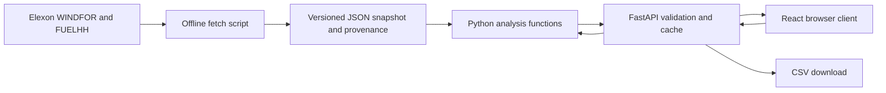

# Technical handover

## Request flow

Docker serves the compiled frontend and API from one Python process. Development uses Vite's API proxy. Vercel uses static assets plus the identical FastAPI app behind a Python function; this avoids a JavaScript reimplementation of business logic.

## Key choices

**Immutable snapshot:** January is historical, small and fixed. JSON avoids unnecessary database infrastructure, works read-only in serverless functions, and supports exact reproducibility. Provenance stores exact query URLs and SHA-256 hashes. A future continuously updated product would use versioned object storage and a transactional snapshot manifest.

**Pure analysis core:** No HTTP, environment variables or filesystem access in the analytical functions. Tests can construct publication-boundary cases precisely. Forecast lookup groups by delivery target and chooses the maximum eligible publication. Actual deduplication chooses the latest available publication. No interpolation is performed.

**Explicit time semantics:** Parse source timestamps as timezone-aware UTC, construct decision times in Europe/London and emit UTC ISO timestamps. January has no DST transitions; the scope intentionally fixes January rather than claiming a general 23/25-hour delivery-day implementation.

**Coverage before certainty:** Every expected hour appears in the API. Missing inputs remain null, unmatched pairs are excluded from error statistics, and denominator counts remain visible. A full-day energy headline requires all 24 forecasts.

**Bounded caching:** One cached raw snapshot and up to 128 cached analysis parameter sets per worker. Fetching is never on the request path. Restart after replacing snapshots. Each worker holds an independent cache; this is acceptable for the static pilot.

**Simple interaction state:** React owns filters, selected day, navigation, loading and failures. Aborted fetches prevent stale results after rapid filter changes. Native date/time/select controls support keyboard interaction. Charts have textual summaries and a tabular alternative.

## What is deliberately outside scope

- Demand, commercial positions, price optimisation, financial savings claims and trade execution.
- Embedded or unmetered wind not represented by the two required Elexon datasets.
- Authentication/multi-tenancy; this app exposes public historical data only.
- A calibrated confidence interval, reserve policy, or automated buying recommendation.
- Scheduled ingestion and future-date support.

## Operational considerations

The container uses a non-root user and a health check. The API exposes no mutation endpoints or arbitrary URL fetches. Dependencies are lockfile/pin based; the included CI template tests, compiles and builds the image when activated. Public data need no secrets. Credentials used for GitHub publication are held by the user's existing credential manager and are never written to project files.

For a production extension, add upstream response schema validation, monitoring, transactional snapshot refresh, a backtesting split for risk calibration, and a deployment smoke test. Do not add market demand or prices to this submission without changing the agreed data scope.
